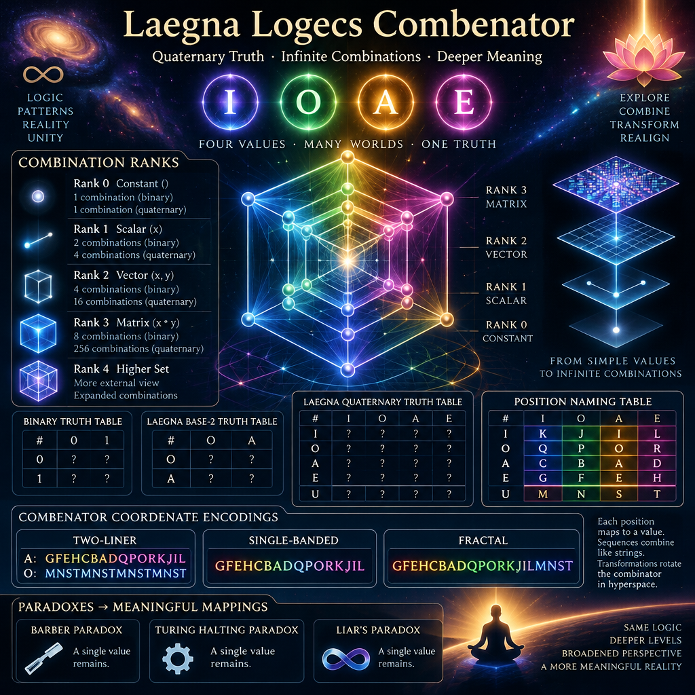

<br>

# Laegna Logecs Combenator

Laegna Logecs Combenator is used for listing and floating of all of the Combenations.

# Combination Ranks

Combination ranks:
- Rank 0, Constant ():
  - Constant value 1 is result of each operation.
  - 1 table row header "1", single unnamed column.
  - 1 combination binary, 1 quaternary.
- Rank 1, Scalar (x):
  - Input 0 or 1 is converted to `?` (either 0 or 1).
  - 1 table row header set "1" to "2" (binary) or "4" (quaternary).
  - 2 combinations binary, 4 quaternary.
- Rank 2, Vector (x, y):
  - Input is two booleans, both 0 or 1, converted to four `?`'s.
  - 4 combinations binary / or 3 binary low, 16 quaternary / or 8 quaternary low.
- Rank 3, Matrix (x * y):
  - This contains the answer space for rank 2, the system is complicated.
  - 8 combinations binary / or 6 binary low, 256 for quaternary / or 192 quaternary low / or 65536 complex combinator set.

Rank 0 can be removed and rank 4 added to realign it to higher set of 0=1, other equivalent hologram view of this order - more external.
- Various ways are there to project different things.

Laegna is Quaternary system - base-4 Truth Values.

# Binary Truth Table / combination class of ?'s

Binary Truth Table:
```
# 0 1
0 ? ?
1 ? ?
```

Laegna Base-2 Truth Table:
```
# O A
O ? ?
A ? ?
```

Each "`?`" becomes either 0 or 1, or respectively O or A for second table.

We can see for rank 3, there are 2^4 combinations:

# Laegna Logecs Quaternary Truth Table / combenation class of ?'s

Laegna Truth Table:
```
# I O A E
I ? ? ? ?
O ? ? ? ?
A ? ? ? ?
E ? ? ? ?

U ? ? ? ?
```

Position naming table:
Laegna Truth Table:
```
First frequency creates this quaternary 16; it's used *for power of two values*:
# I O A E
I K J I L
O Q P O R
A C B A D
E G F E H

Second frequency creates this binary 4; it's used *for relative power of single value*:
U M N S T
```

Sometimes we have two digits for this.

Now, convert it to any of these number forms, with positions of each truth value encoded:
- Two-liner:
  
  ```
  A: GFEHCBADQPORKJIL
  O: MNSTMNSTMNSTMNST
  ```
- Single-banded:

  ```
  GFEHCBADQPORKJIL
  ```
- Fractal:

  ```
  GFEHCBADQPORKJILMNST
  ```

In each case, single table content:
- Converts to digitwise meaningful map in Laegna system.

This map is combenator coordenate:
- Each possible value of those 32, 16 or 20 digits needs to be mapped, and number sequences added to each others like strings.
- Changing these combinations now means rotating the combenator in hyperspace:
  - Transformations can be done to change it to meaningful form.

# Paradoxes

Barber Paradox:
Turing halting Paradox:
Liar's paradox:
- In each case, meaningfully a single value is left of two.
- Various ways can be used to map it to low-frequency, single-value band:
  - For example, barber for himself, means single value maps the result - if it's true, his bard is cut;
  - In halting and liar's paradox, again single value is formed, but now in value space not doer space - single value needs result.
  - Still, each paradox must be resolved in these mappings to suitable form; the result will be meaningful.
